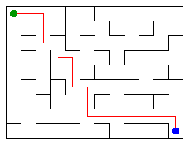

# Assignment 3. Maze Escape

Student ID: 255087        
Name: Almanzor Kamzeyev        
Group: SE-2540       
Maze size (rows x columns): 9 x 12

This file is the report. Fill it in as you go. How to start: `START_HERE.md`. The task: `docs/Assignment3.pdf`.

## Program output

The 13 lines your program prints on your data (`java -cp out Main`):

    Broken: 107
    Kept: 88
    Last broken wall: 161
    MST cost: 36040
    Heaviest broken wall: 865
    Path length: 19
    DFS visited: 72
    Dead ends: 30
    Zones: 8
    Largest zone: 23
    Is DAG: 0
    Flow stages: 4
    Fastest route cost: 14

My maze: The maze was generated using my student ID. The green dot represents the starting cell, and the blue dot represents the exit. The path is found using DFS.

## Questions

Answer in your own words, two or three sentences each.

Mission 0. What do find and union do, and what makes them fast in your code?
The find() method finds the root of the set containing a cell. The union() method joins two different sets and returns false if they are already connected. Path compression and union by size make these operations efficient.

Mission 1. Why is Broken always R*C - 1, and Kept always (R-1)*(C-1)?
The maze contains R × C cells. To connect all cells without creating cycles, exactly R × C − 1 walls must be broken. The total number of internal walls is R(C − 1) + C(R − 1), so the number of remaining walls is (R − 1)(C − 1).

Mission 2. My MST cost from Kruskal and from Prim, and why they are equal:
Kruskal MST cost: 36040

Prim MST cost: 36040

Both algorithms find a minimum spanning tree of the same connected weighted graph. Kruskal processes walls in increasing order of cost and uses DSU to avoid cycles, while Prim expands the tree using a priority queue. Their total costs are equal because both algorithms find an MST.

Mission 3. Why is there exactly one path between two cells? How did you avoid a stack overflow on a huge maze?
There is exactly one simple path between any two cells because the generated maze is a tree. A tree is connected and does not contain cycles. I used iterative DFS with an explicit stack instead of recursion to avoid stack overflow on large mazes.

Mission 4. Why does the second pass of Kosaraju go on the reversed graph? Why do the slides have no cycle exactly when Zones equals the number of cells?
Kosaraju uses the reversed graph during its second DFS pass to identify strongly connected components correctly. The first pass determines the processing order, and the second pass groups mutually reachable cells. Since the input contains no self-loops, the slides form a DAG exactly when every zone contains one cell, so Zones equals the number of cells.

Mission 5. Why is it enough to go through the zones in the order of their numbers? What does this pass cost?
The zones are numbered in topological order. Therefore, every preceding zone is processed before the zones it can reach, allowing dynamic programming to calculate the longest chain and cheapest route. Once the zone graph is built, the pass takes O(Z + E) time, where Z is the number of zones and E is the number of edges between zones.

## AI use

I used ChatGPT to help understand the algorithms, prepare Java implementation examples, and review and debug code. I reviewed and adapted the implementations for my project and tested the results using the provided checker.

## Timing (Mission 7)

Milliseconds, 5 runs each, from `java -cp out Bench`.

| maze | Kruskal | Prim |
|---|---|---|
| 100 x 100 | 19 | 14 |
| 300 x 300 | 88 | 137 |
| 1000 x 1000 | 1484 | 4120 |

What do the numbers say about how the time grows? Two or three sentences.
The execution time of both algorithms generally increases as the maze size grows. For the 100 x 100 maze, Prim was slightly faster than Kruskal. However, for larger mazes, Kruskal performed better. On the 1000 x 1000 maze, Kruskal took 1484 ms, while Prim took 4120 ms.

Kruskal sorts the walls by weight and uses DSU, while Prim uses a priority queue. Their performance depends on the maze size and the implementation of each algorithm

## Complexity

n is the number of cells, m the number of walls (or slides). Fill in every algorithm you wrote.

| algorithm | time | space | assumptions |
|---|---|---|---|
| DSU find and union | O(α(n)) amortized | O(n) |  Path compression and union by size|
| Kruskal | O(m log m) | O(n + m) | Sorting edges and using DSU |
| Prim | O(m log m) | O(n + m) | Priority queue and adjacency lists |
| DFS | O(n + m) | O(n + m) | Iterative DFS using a stack |
| Kosaraju | O(n + m) | O(n + m) | Two DFS passes, including the reversed graph |
| Route in the zone graph | O(m + Z + E) | O(m + Z + E) | Build the zone graph and process zones in topological order |

The DSU operations are efficient because path compression and union by size reduce the cost of repeated operations. Kruskal sorts edges, while Prim uses a priority queue. DFS and Kosaraju visit vertices and edges in linear time. The shortest route algorithm uses dynamic programming on the DAG of zones.

## Before you submit

- data/walls.txt, data/slides.txt and output/maze.png are in the repository.
- `java tools/Check.java` shows all examples right.
- This README is filled in, the program output and the section AI use included.
- The work is pushed to main (at least one commit per mission) and the repository is public.
- The link is attached in Moodle.
## Before you submit

- [✓] `data/walls.txt`, `data/slides.txt`, and `output/maze.png` are included in the repository.
- [✓] `java tools/Check.java` passes all example tests.
- [✓] The README contains the program output, algorithm explanations, timing results, complexity table, and AI use section.
- [✓] All missions have been committed separately to the main branch.
- [✓] The repository is public and all commits have been pushed to GitHub.
- [✓] The GitHub repository link has been submitted in Moodle.
